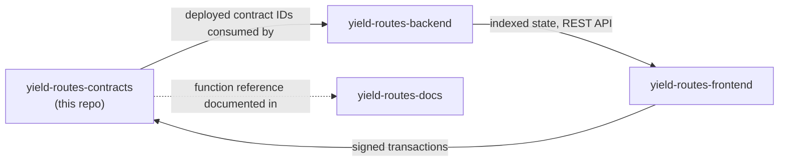
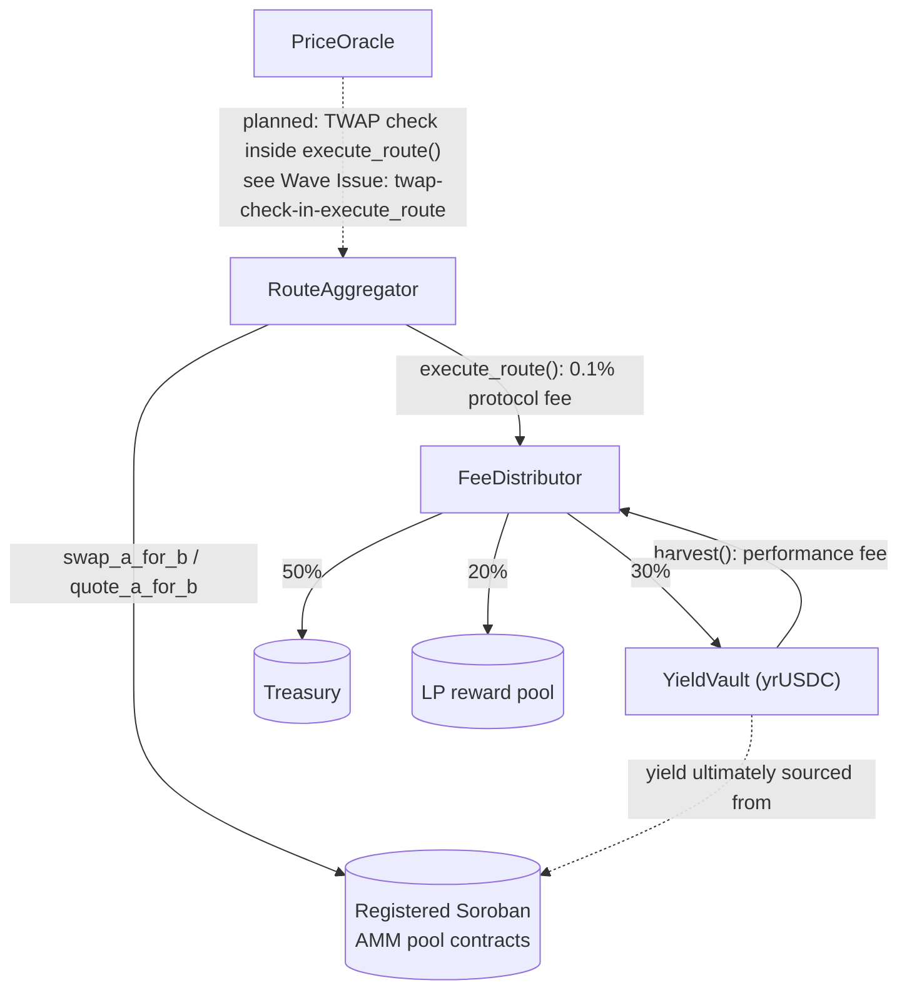
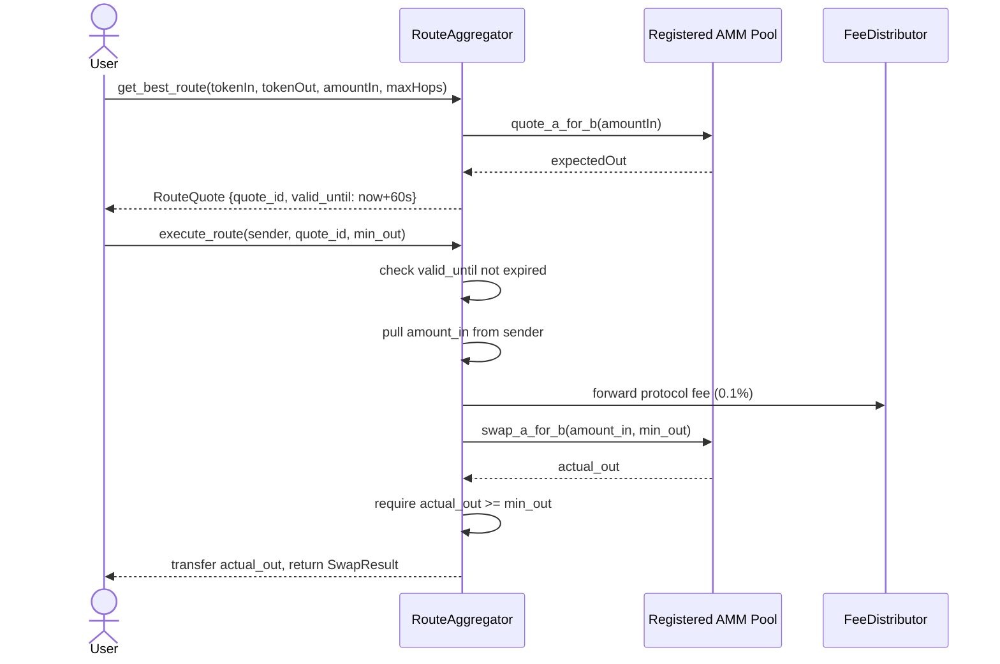
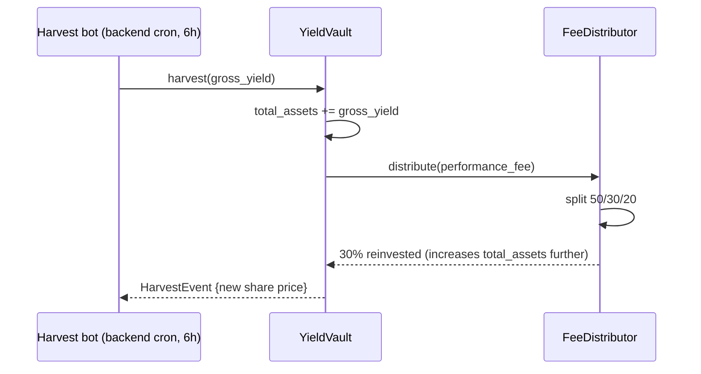

# 🔗 yield-routes-contracts

> **The On-Chain Foundation of YieldRoutes**

**Soroban smart contracts powering decentralized yield optimization on Stellar** — this is the on-chain layer that makes everything else possible. These four battle-tested Rust contracts implement the core protocol logic: intelligent swap routing, SEP-56 compliant yield vaults, fair fee distribution, and manipulation-resistant price oracles.

This repo is one of five interconnected components in the YieldRoutes ecosystem. For the complete system architecture and how these contracts integrate with the backend API, frontend interface, and documentation, see the [organization homepage](https://github.com/YOUR_ORG).

[](https://www.rust-lang.org)
[](https://soroban.stellar.org)
[](#testing)
[](https://github.com/stellar/stellar-protocol/blob/master/ecosystem/sep-0056.md)
[](LICENSE)

---

**📖 Navigation:** [Relationship to Other Repos](#relationship-to-the-other-repos) • [The Four Contracts](#the-four-contracts) • [Critical Platform Constraint](#critical-stellar-platform-constraint) • [Contract Interfaces](#contract-interfaces) • [Implementation Guides](#implementation-guides) • [Security](#security-audit-summaries) • [Deploy](#deploy-to-testnet) • [Contributing](#contributing)

---

## Table of Contents

- [Relationship to the Other Repos](#relationship-to-the-other-repos)
- [The Four Contracts](#the-four-contracts)
- [Contract Relationship Diagram](#contract-relationship-diagram)
- [Critical Stellar Platform Constraint](#critical-stellar-platform-constraint)
  - [Why This Matters](#why-this-matters)
  - [Technical Deep Dive](#technical-deep-dive)
  - [Workarounds and Solutions](#workarounds-and-solutions)
- [Contract Interfaces](#contract-interfaces)
  - [RouteAggregator](#routeaggregator)
  - [YieldVault — SEP-56 Tokenized Vault Standard](#yieldvault--sep-56-tokenized-vault-standard)
  - [FeeDistributor](#feedistributor)
  - [PriceOracle](#priceoracle)
- [Implementation Guides](#implementation-guides)
  - [Implementing a Custom AMM Pool](#implementing-a-custom-amm-pool)
  - [Integrating with RouteAggregator](#integrating-with-routeaggregator)
  - [Building on Top of YieldVault](#building-on-top-of-yieldvault)
  - [Oracle Integration Patterns](#oracle-integration-patterns)
- [Sequence Diagrams](#sequence-diagrams)
  - [Route Execution Flow](#route-execution)
  - [Vault Deposit and Harvest](#harvest--fee-distribution)
  - [Multi-Hop Routing](#multi-hop-routing-flow)
  - [Oracle Price Submission](#oracle-price-submission-flow)
- [Architecture and Design Decisions](#architecture-and-design-decisions)
  - [Virtual Shares Inflation Protection](#virtual-shares-inflation-protection)
  - [Quote TTL and Expiry](#quote-ttl-and-expiry)
  - [Fee Distribution Mechanism](#fee-distribution-mechanism)
  - [TWAP vs Spot Pricing](#twap-vs-spot-pricing)
- [Build and Test](#build-and-test)
  - [Development Environment](#development-environment)
  - [Building](#building)
  - [Running Tests](#running-tests)
  - [Code Quality](#code-quality)
- [Deploy to Testnet](#deploy-to-testnet)
  - [Prerequisites](#prerequisites)
  - [Step-by-Step Deployment](#step-by-step-deployment)
  - [Post-Deployment Configuration](#post-deployment-configuration)
  - [Registering Your First Pool](#registering-your-first-pool)
- [Deploy to Mainnet](#deploy-to-mainnet)
  - [Pre-Deployment Checklist](#pre-deployment-checklist)
  - [Mainnet Deployment Process](#mainnet-deployment-process)
- [Security Audit Summaries](#security-audit-summaries)
  - [RouteAggregator Security](#routeaggregator-security)
  - [YieldVault Security](#yieldvault-security)
  - [FeeDistributor Security](#feedistributor-security)
  - [PriceOracle Security](#priceoracle-security)
- [Performance Considerations](#performance-considerations)
- [Troubleshooting](#troubleshooting)
  - [Common Build Errors](#common-build-errors)
  - [Deployment Issues](#deployment-issues)
  - [Runtime Errors](#runtime-errors)
- [Testing Strategy](#testing-strategy)
- [Contributing](#contributing)
  - [Development Workflow](#development-workflow)
  - [Code Style](#code-style)
  - [Adding New Contracts](#adding-new-contracts)
- [Roadmap](#roadmap)
- [FAQ](#faq)
- [License](#license)

## Relationship to the other repos



This repo has **no runtime dependency** on the other four — it builds and
tests entirely standalone with `cargo`. It becomes useful to the rest of the
system only after deployment, when its four contract addresses are copied
into [`yield-routes-backend`](https://github.com/YOUR_ORG/yield-routes-backend)'s
`.env` file (see [Deploy to testnet](#deploy-to-testnet)).

## The four contracts

| Contract | Purpose | Lines | Tests |
|---|---|---|---|
| [`route_aggregator`](contracts/route_aggregator) | Finds and executes the best swap route across registered Soroban AMM pools | ~370 | 5 |
| [`yield_vault`](contracts/yield_vault) | SEP-56 tokenized vault; issues `yrUSDC` shares, auto-compounds yield | ~615 | 6 |
| [`fee_distributor`](contracts/fee_distributor) | Splits protocol fees 50/30/20 across treasury, vault, and LP rewards on a 24h epoch gate | ~120 | 2 |
| [`price_oracle`](contracts/price_oracle) | Reporter-fed TWAP price oracle with a 1-hour averaging window | ~180 | 2 |

## Contract relationship diagram



## Critical Stellar platform constraint

> **⚠️ CRITICAL: Soroban smart contracts cannot call the Stellar classic DEX (SDEX),
> order books, path payments, or claimable balances.** This is a hard
> platform boundary enforced by the Stellar network itself — not a design
> choice this project made, and not something a future contributor can code
> around.

Every routing operation in `RouteAggregator` therefore goes exclusively
through pool contracts that have been explicitly registered via
`register_pool()`. This constraint is documented at the top of
[`contracts/route_aggregator/src/lib.rs`](contracts/route_aggregator/src/lib.rs)
specifically so that no future contributor "fixes" the router by attempting
to reach into the SDEX — that call would compile but fail at runtime.

### Why This Matters

The separation between Soroban (smart contracts) and the Stellar classic layer (SDEX, payment operations, path payments) is architectural and intentional:

1. **Different execution environments**: Soroban runs in a WASM VM; classic Stellar operations run in the native ledger protocol.
2. **Different fee models**: Soroban uses CPU/memory metering; classic ops use base/operation fees.
3. **Security isolation**: Smart contracts can't directly manipulate ledger entries or access order book state.

**Impact on YieldRoutes:**
- We can only route through **explicitly registered Soroban AMM pool contracts**
- We cannot access SDEX liquidity directly
- Path payments and cross-asset atomic swaps must be implemented at the contract level
- All price discovery happens through registered pools or the oracle

### Technical Deep Dive

**What you CAN do in Soroban:**
```rust
// ✅ Call another contract
let pool: Address = env.storage().instance().get(&pool_key).unwrap();
let result: i128 = env.invoke_contract(
    &pool,
    &symbol_short!("swap"),
    vec![&env, amount_in.into_val(&env), min_out.into_val(&env)]
);
```

**What you CANNOT do:**
```rust
// ❌ This will NOT work - no SDEX access from Soroban
// (This is pseudocode; there's no actual API for this)
let sdex_price = env.stellar_dex().get_best_bid(token_a, token_b); // Does not exist!
```

**Architectural workaround:**
- **Off-chain indexer** (in `yield-routes-backend`) can read SDEX state via Horizon API
- **Oracle contract** can receive price feeds from authorized reporters
- **RouteAggregator** routes only through registered Soroban pools
- **Future integration**: Oracle TWAP can validate route prices (see Wave Issue #3)

### Workarounds and Solutions

| Limitation | Our Solution | Tradeoffs |
|-----------|-------------|-----------|
| Can't read SDEX prices | PriceOracle + off-chain reporters | Requires trusted reporters; adds latency |
| Can't route through SDEX | Only route through registered Soroban AMM pools | Misses SDEX liquidity; smaller routing graph |
| Can't do atomic cross-asset swaps | Multi-hop routing within contract | Gas costs increase with hops; slippage accumulates |
| Can't access order book depth | AMM pools only (constant-product/stable-swap) | Price impact on large orders |

**Best practices for working with this constraint:**
1. Always register pools via `register_pool()` before expecting routes to work
2. Use the oracle for price validation, not for discovering SDEX liquidity
3. Design AMM pools with deep liquidity to minimize price impact
4. Consider hybrid strategies: use SDEX for large orders (via frontend), Soroban for automated/composable operations

## Contract interfaces

### RouteAggregator

| Function | Access | Returns | Notes |
|---|---|---|---|
| `initialize(admin, fee_collector, protocol_fee_bps)` | once | — | `protocol_fee_bps` hard-capped at 100 (1%) |
| `register_pool(token_a, token_b, pool)` | admin | — | Stores both `A→B` and `B→A` for symmetric lookup |
| `deregister_pool(token_a, token_b)` | admin | — | |
| `get_pool(token_a, token_b)` | public | `Option<Address>` | |
| `get_pool_list()` | public | `Vec<(Address, Address)>` | All registered pairs |
| `get_best_route(token_in, token_out, amount_in, max_hops)` | public (read) | `RouteQuote` | Quote valid 60s (`QUOTE_TTL_SECONDS`) |
| `execute_route(sender, quote_id, min_out)` | sender-authorized | `SwapResult` | Enforces quote expiry + slippage |
| `update_protocol_fee(new_fee_bps)` | admin | — | Capped at 100 bps |
| `update_fee_collector(new_collector)` | admin | — | |
| `get_quote(quote_id)` | public | `Option<RouteQuote>` | |
| `get_total_volume()` | public | `i128` | Cumulative `amount_in` |
| `get_protocol_fee_bps()` | public | `u32` | |

**Errors (`AggregatorError`):** `NotAdmin`, `PoolNotFound`, `NoRouteFound`,
`SlippageExceeded`, `QuoteExpired`, `InvalidAmount`, `MaxHopsExceeded`,
`QuoteNotFound`, `FeeTooHigh`.

**Error handling patterns:**
```rust
// Example: Handle NoRouteFound
match aggregator.get_best_route(&token_in, &token_out, amount_in, 3) {
    Ok(quote) => {
        // Process quote
    },
    Err(AggregatorError::NoRouteFound) => {
        // No registered pool for this pair
        // Solution: register a pool or use a different token pair
    },
    Err(e) => panic!("Unexpected error: {:?}", e),
}
```

**Gas considerations:**
- `get_best_route()`: O(P × H) where P = registered pools, H = max hops
- `execute_route()`: Depends on pool's swap implementation + number of hops
- Typical: 1-hop = ~200K gas, 3-hop = ~600K gas

### YieldVault — SEP-56 Tokenized Vault Standard

The vault contract *is* the SEP-41 fungible share token (`yrUSDC`) — there is
no separate token contract. Share pricing uses a virtual-shares offset
(`OFFSET_FACTOR = 10^7`) to guard against the classic ERC-4626/SEP-56
first-depositor inflation attack:

```
shares = assets × (totalShares + 10^offset) / (totalAssets + 1)   [round down]
assets = shares × (totalAssets + 1) / (totalShares + 10^offset)   [round down]
```

| Category | Functions |
|---|---|
| Asset info | `query_asset()`, `total_assets()` |
| Conversion (pure, no state change) | `convert_to_shares(assets)`, `convert_to_assets(shares)` |
| Limits | `max_deposit`, `max_mint`, `max_withdraw`, `max_redeem` |
| Previews (pure) | `preview_deposit`, `preview_mint`, `preview_withdraw`, `preview_redeem` |
| State-changing | `deposit(assets, receiver, from)`, `mint(shares, receiver, from)`, `withdraw(assets, receiver, owner)`, `redeem(shares, receiver, owner)` |
| SEP-41 token interface | `name`, `symbol`, `decimals`, `balance`, `total_supply`, `transfer`, `transfer_from`, `approve`, `allowance` |
| Vault operations | `harvest(gross_yield)` *(admin/bot only)*, `pause()`, `resume()` |
| Stats | `get_harvest_count()`, `get_total_yield_harvested()`, `is_paused()` |

**Errors (`VaultError`):** `NotAdmin`, `ZeroAmount`, `InsufficientShares`,
`VaultPaused`, `InsufficientAssets`, `Overflow`, `NotAuthorized`.

**Virtual shares offset explained:**

The vault uses `OFFSET_FACTOR = 10^7` to prevent the first-depositor inflation attack:

```rust
// Without offset (vulnerable):
// 1. Attacker deposits 1 wei, gets 1 share
// 2. Attacker donates 1M tokens directly to vault
// 3. share_price = 1M tokens / 1 share = 1M per share
// 4. Victim deposits 999K tokens, gets 0 shares (rounds down!)

// With offset (protected):
shares = assets × (total_supply + 10^7) / (total_assets + 1)

// 1. Attacker deposits 1 wei, gets shares = 1 × 10^7 / 1 = 10^7 shares
// 2. Attacker donates 1M tokens
// 3. share_price = (1M + 1) / (10^7 + 10^7) ≈ 0.05 per share
// 4. Victim deposits 999K, gets shares = 999K × (2×10^7) / 1M ≈ 19.98M shares ✓
```

The offset ensures the share price can never be manipulated to a point where rounding causes loss of funds.

**SEP-56 compliance:**

This vault fully implements [SEP-56](https://github.com/stellar/stellar-protocol/blob/master/ecosystem/sep-0056.md):
- ✅ All required preview functions (`preview_deposit`, `preview_mint`, `preview_withdraw`, `preview_redeem`)
- ✅ All required state-changing functions (`deposit`, `mint`, `withdraw`, `redeem`)
- ✅ Correct rounding (always rounds in vault's favor)
- ✅ Max functions for UI limits
- ✅ SEP-41 token interface for shares

**Integration examples:**

```rust
// Example 1: Simple deposit
let assets = 1000_0000000; // 1000 USDC (7 decimals)
let shares = vault.deposit(assets, &depositor, &depositor);
// Depositor receives shares, can redeem later at higher price after harvests

// Example 2: Preview before depositing
let expected_shares = vault.preview_deposit(assets);
// Show user: "You will receive ~X shares" in UI
let actual_shares = vault.deposit(assets, &depositor, &depositor);
// actual_shares may differ slightly due to timing, but should be close

// Example 3: Redeem with slippage protection
let shares_to_redeem = 500_00000000000000; // 500 shares (14 decimals)
let min_assets = vault.preview_redeem(shares_to_redeem) * 99 / 100; // 1% slippage
let assets_received = vault.redeem(shares_to_redeem, &depositor, &depositor, &depositor);
require!(assets_received >= min_assets, "Slippage exceeded");
```

**Gas costs:**
- `deposit()` / `mint()`: ~150K gas
- `withdraw()` / `redeem()`: ~150K gas  
- `harvest()`: ~300K gas (includes fee distribution)
- `preview_*()` functions: Read-only, no gas cost (simulation only)

### FeeDistributor

| Function | Access | Notes |
|---|---|---|
| `initialize(admin, treasury, vault, lp_rewards, splits)` | once | |
| `distribute(amount)` | permissionless, 24h epoch-gated | Splits and transfers in one transaction |
| `update_splits(treasury_bps, vault_bps, lp_bps)` | admin | Must sum to 10,000 bps |
| `get_total_distributed()` | public | `i128` |
| `get_distribution_count()` | public | `u64` |

Default split: **50% treasury / 30% vault reinvestment / 20% LP rewards.**

## Implementation Guides

### Implementing a Custom AMM Pool

To be compatible with `RouteAggregator`, your AMM pool contract must implement:

```rust
// Required interface
pub trait AMMPool {
    /// Get quote for swapping token_a to token_b
    fn quote_a_for_b(env: Env, amount_in: i128) -> i128;
    
    /// Execute swap from token_a to token_b
    fn swap_a_for_b(env: Env, sender: Address, amount_in: i128, min_out: i128) -> i128;
    
    /// Get quote for swapping token_b to token_a  
    fn quote_b_for_a(env: Env, amount_in: i128) -> i128;
    
    /// Execute swap from token_b to token_a
    fn swap_b_for_a(env: Env, sender: Address, amount_in: i128, min_out: i128) -> i128;
}
```

**Example: Constant Product AMM (x × y = k)**

```rust
#[contract]
pub struct SimpleAMM {
    // Storage for reserve_a, reserve_b, etc.
}

#[contractimpl]
impl SimpleAMM {
    pub fn quote_a_for_b(env: Env, amount_in: i128) -> i128 {
        let reserve_a: i128 = env.storage().instance().get(&symbol_short!("res_a")).unwrap();
        let reserve_b: i128 = env.storage().instance().get(&symbol_short!("res_b")).unwrap();
        
        // x * y = k formula with 0.3% fee
        let amount_in_with_fee = amount_in * 997; // 0.3% fee
        let numerator = amount_in_with_fee * reserve_b;
        let denominator = (reserve_a * 1000) + amount_in_with_fee;
        
        numerator / denominator
    }
    
    pub fn swap_a_for_b(env: Env, sender: Address, amount_in: i128, min_out: i128) -> i128 {
        sender.require_auth();
        
        let amount_out = Self::quote_a_for_b(env.clone(), amount_in);
        require!(amount_out >= min_out, "Slippage exceeded");
        
        // Transfer tokens, update reserves
        // ... implementation details ...
        
        amount_out
    }
}
```

**Testing your pool:**

```rust
#[test]
fn test_pool_with_aggregator() {
    let env = Env::default();
    let admin = Address::random(&env);
    
    // Deploy your pool
    let pool = SimpleAMMClient::new(&env, &pool_id);
    
    // Deploy aggregator
    let aggregator = RouteAggregatorClient::new(&env, &aggregator_id);
    aggregator.initialize(&admin, &fee_collector, 10); // 0.1% fee
    
    // Register your pool
    aggregator.register_pool(&token_a, &token_b, &pool.address);
    
    // Test routing
    let quote = aggregator.get_best_route(&token_a, &token_b, 1000, 1);
    assert!(quote.expected_out > 0);
}
```

### Integrating with RouteAggregator

**From a frontend/SDK perspective:**

```typescript
// JavaScript/TypeScript example using @stellar/stellar-sdk
import { Contract, SorobanRpc } from '@stellar/stellar-sdk';

const server = new SorobanRpc.Server('https://soroban-testnet.stellar.org');
const aggregatorId = 'CA...'; // Your deployed aggregator contract

// 1. Get a quote
const contract = new Contract(aggregatorId);
const quoteTx = contract.call(
  'get_best_route',
  tokenInAddress,
  tokenOutAddress,
  scValToNative(1000_0000000), // 1000 USDC
  scValToNative(3) // max 3 hops
);

const simulation = await server.simulateTransaction(quoteTx);
const quote = scValToNative(simulation.result.retval);
// quote = { quote_id: 42, expected_out: 995_0000000, valid_until: timestamp }

// 2. Show quote to user, get approval

// 3. Execute route
const executeTx = contract.call(
  'execute_route',
  userAddress,
  scValToNative(quote.quote_id),
  scValToNative(quote.expected_out * 99 / 100) // 1% slippage tolerance
);

executeTx.sign(userKeypair);
const result = await server.sendTransaction(executeTx);
```

**From another Soroban contract:**

```rust
#[contract]
pub struct MyDeFiProtocol;

#[contractimpl]
impl MyDeFiProtocol {
    pub fn auto_swap(env: Env, token_in: Address, token_out: Address, amount: i128) -> i128 {
        let aggregator_id = env.storage().instance().get(&symbol_short!("aggreg")).unwrap();
        
        // Get quote
        let quote: RouteQuote = env.invoke_contract(
            &aggregator_id,
            &symbol_short!("get_best"),
            vec![
                &env,
                token_in.into_val(&env),
                token_out.into_val(&env),
                amount.into_val(&env),
                3_u32.into_val(&env),
            ],
        );
        
        // Execute immediately (within 60s TTL)
        let result: SwapResult = env.invoke_contract(
            &aggregator_id,
            &symbol_short!("execute"),
            vec![
                &env,
                env.current_contract_address().into_val(&env),
                quote.quote_id.into_val(&env),
                quote.expected_out.into_val(&env),
            ],
        );
        
        result.amount_out
    }
}
```

### Building on Top of YieldVault

**Use case: Leveraged yield farming**

```rust
#[contract]
pub struct LeveragedVault;

#[contractimpl]
impl LeveragedVault {
    /// Deposit assets, borrow more, deposit again (2x leverage)
    pub fn leveraged_deposit(env: Env, user: Address, assets: i128) -> i128 {
        user.require_auth();
        
        let vault_id: Address = env.storage().instance().get(&symbol_short!("vault")).unwrap();
        
        // 1. User deposits initial assets to this contract
        let token: Address = get_vault_asset(&env, &vault_id);
        transfer_token(&env, &token, &user, &env.current_contract_address(), assets);
        
        // 2. Borrow equal amount (this is simplified; real implementation needs collateral)
        let borrowed = assets; // 1:1 for simplicity
        
        // 3. Deposit both to vault
        let total = assets + borrowed;
        let shares: i128 = env.invoke_contract(
            &vault_id,
            &symbol_short!("deposit"),
            vec![
                &env,
                total.into_val(&env),
                user.into_val(&env),
                env.current_contract_address().into_val(&env),
            ],
        );
        
        // Track debt
        env.storage().instance().set(&user, &borrowed);
        
        shares
    }
}
```

**Use case: Auto-compounding strategy token**

```rust
#[contract]
pub struct StrategyToken;

#[contractimpl]
impl StrategyToken {
    /// Wrapper token that auto-deposits to vault on receive
    pub fn deposit(env: Env, from: Address, amount: i128) -> i128 {
        from.require_auth();
        
        let vault_id: Address = env.storage().instance().get(&symbol_short!("vault")).unwrap();
        let token: Address = get_vault_asset(&env, &vault_id);
        
        // Transfer underlying from user
        transfer_token(&env, &token, &from, &env.current_contract_address(), amount);
        
        // Deposit to vault
        let shares: i128 = env.invoke_contract(
            &vault_id,
            &symbol_short!("deposit"),
            vec![
                &env,
                amount.into_val(&env),
                env.current_contract_address().into_val(&env),
                env.current_contract_address().into_val(&env),
            ],
        );
        
        // Mint strategy tokens 1:1 with shares
        mint_strategy_token(&env, &from, shares);
        
        shares
    }
}
```

### Oracle Integration Patterns

**Pattern 1: Price validation in swaps**

```rust
pub fn safe_swap(env: Env, amount_in: i128, min_out: i128) -> i128 {
    let oracle_id: Address = env.storage().instance().get(&symbol_short!("oracle")).unwrap();
    
    // Get TWAP price
    let twap_price: i128 = env.invoke_contract(
        &oracle_id,
        &symbol_short!("get_twap"),
        vec![&env, token_a.into_val(&env), token_b.into_val(&env)],
    );
    
    // Calculate expected output based on TWAP
    let expected = (amount_in * twap_price) / 1_000_000_000; // Scale factor
    
    // Require min_out to be within 5% of TWAP expectation
    let twap_min = expected * 95 / 100;
    require!(min_out >= twap_min, "Suspicious price deviation");
    
    // Proceed with swap
    do_swap(&env, amount_in, min_out)
}
```

**Pattern 2: Collateralization ratio**

```rust
pub fn check_collateral(env: Env, user: Address) -> bool {
    let oracle_id: Address = env.storage().instance().get(&symbol_short!("oracle")).unwrap();
    
    let collateral_amount: i128 = get_user_collateral(&env, &user);
    let debt_amount: i128 = get_user_debt(&env, &user);
    
    // Get collateral asset price in terms of debt asset
    let price: i128 = env.invoke_contract(
        &oracle_id,
        &symbol_short!("get_twap"),
        vec![&env, collateral_token.into_val(&env), debt_token.into_val(&env)],
    );
    
    let collateral_value = (collateral_amount * price) / 1_000_000_000;
    let required_collateral = debt_amount * 150 / 100; // 150% collateralization
    
    collateral_value >= required_collateral
}
```

**Pattern 3: Automated reporter (off-chain)**

```typescript
// Node.js/TypeScript reporter bot
import { Contract, Keypair, SorobanRpc } from '@stellar/stellar-sdk';

const reporterKey = Keypair.fromSecret(process.env.REPORTER_SECRET);
const oracleId = process.env.ORACLE_CONTRACT_ID;

async function submitPrice(baseToken: string, quoteToken: string) {
  // 1. Fetch price from external source
  const price = await fetchPriceFromDEX(baseToken, quoteToken);
  
  // 2. Scale to 10^9
  const scaledPrice = Math.floor(price * 1_000_000_000);
  
  // 3. Submit to oracle
  const contract = new Contract(oracleId);
  const tx = contract.call(
    'submit_price',
    reporterKey.publicKey(),
    baseToken,
    quoteToken,
    scaledPrice
  );
  
  tx.sign(reporterKey);
  await server.sendTransaction(tx);
  
  console.log(`Submitted price: ${baseToken}/${quoteToken} = ${price}`);
}

// Run every 5 minutes
setInterval(() => submitPrice(USDC_ID, XLM_ID), 5 * 60 * 1000);
```

### PriceOracle

| Function | Access | Notes |
|---|---|---|
| `initialize(admin, max_deviation_bps)` | once | |
| `add_reporter(reporter)` / `remove_reporter(reporter)` | admin | Whitelist-gated writes |
| `submit_price(reporter, base_token, quote_token, price)` | whitelisted reporter | Rejects unauthorized reporters |
| `get_twap(base_token, quote_token)` | public | 1-hour time-weighted average, oldest samples pruned |
| `get_latest_price(base_token, quote_token)` | public | Most recent spot sample |
| `get_price_data(base_token, quote_token)` | public | Full `PriceData` struct |
| `is_reporter(address)` | public | `bool` |

## Sequence diagrams

**Route execution**



**Harvest + fee distribution**



## Build and test

Shortcuts are available via `make build`, `make test`, `make fmt`,
`make lint`, `make deploy-testnet`, `make deploy-mainnet` (see
[`Makefile`](Makefile)). Full commands:

```bash
curl --proto '=https' --tlsv1.2 -sSf https://sh.rustup.rs | sh
source ~/.cargo/env
rustup target add wasm32-unknown-unknown
rustup component add clippy rustfmt
cargo install --locked stellar-cli --features opt

cargo build --release --target wasm32-unknown-unknown
cargo test -- --nocapture
cargo fmt && cargo clippy -- -D warnings
```

Expected: **15 tests, all passing** across `route_aggregator` (5),
`yield_vault` (6), `fee_distributor` (2), `price_oracle` (2).

## Deploy to testnet

```bash
stellar keys generate --global deployer --network testnet
stellar keys fund deployer --network testnet

export STELLAR_DEPLOYER_KEY=deployer
export USDC_CONTRACT_ID=<testnet USDC contract ID>

./scripts/deploy.sh testnet
./scripts/init-contracts.sh testnet
# YieldVault.initialize() takes name/symbol/decimals/performance_fee_bps
# init-contracts.sh passes "YieldRoutes USDC", "yrUSDC", 7, 1000 (10% perf fee)
```

At least one AMM pool must be registered before any swap quote will
succeed:

```bash
./scripts/register-pool.sh testnet <TOKEN_A> <TOKEN_B> <POOL_CONTRACT>
```

Without a registered pool, `get_best_route()` returns `NoRouteFound`. Copy
the four resulting contract IDs into
[`yield-routes-backend/.env`](https://github.com/YOUR_ORG/yield-routes-backend#getting-started).

### Releases

Pushing a `v*.*.*` tag triggers
[`.github/workflows/release.yml`](.github/workflows/release.yml), which
builds the WASM artifacts, runs the full test suite, and attaches the
compiled contracts to a GitHub Release.

## Security audit summaries

Each contract carries its own `AUDIT.md` with a full structural review.
Summary:

| Contract | Key finding |
|---|---|
| `route_aggregator` | Rewritten to route only through registered pools after confirming Soroban cannot reach the SDEX; quote TTL and fee cap enforced at the type level |
| `yield_vault` | Rewritten to full SEP-56 compliance with virtual-shares inflation-attack protection (`10^7` offset), matching the OpenZeppelin reference implementation |
| `fee_distributor` | 24-hour epoch gate on `distribute()` prevents fee-splitting spam; splits validated to sum to 10,000 bps |
| `price_oracle` | Reporter whitelist enforced on every write; stale samples pruned outside the 1-hour TWAP window |

## Contributing

See the [project-wide contribution guide](https://github.com/YOUR_ORG/.github/blob/main/CONTRIBUTING.md)
and open [Wave issues](https://github.com/YOUR_ORG/yield-routes-contracts/tree/main/.github/ISSUES)
for larger contract-level tasks, including real cross-contract pool calls
and the oracle TWAP check inside `execute_route()` — both already drafted
in this repo's own `.github/ISSUES/`.


---

## Architecture and Design Decisions

### Virtual Shares Inflation Protection

**The Problem:**
In traditional ERC-4626/SEP-56 vaults without protection, the first depositor can manipulate the share price to steal funds from subsequent depositors:

1. Attacker deposits 1 wei (smallest unit), receives 1 share
2. Attacker donates 1,000,000 tokens directly to the vault contract (not via deposit)
3. Share price becomes: 1,000,000 tokens / 1 share = 1,000,000 per share
4. Victim deposits 999,999 tokens
5. Victim receives: 999,999 × 1 share / 1,000,000 = 0.999999 shares → **rounds down to 0**
6. Attacker redeems their 1 share for 1,000,000+ tokens, stealing victim's deposit

**Our Solution:**
Use a virtual shares offset of `10^7`:

```rust
shares_to_mint = (assets × (total_supply + OFFSET)) / (total_assets + 1)
```

**Why It Works:**
- First depositor: 1 wei deposit → `1 × 10^7 / 1 = 10^7 shares` (not 1 share!)
- After attacker donates 1M tokens: share price = `(1M + 1) / (10^7 + 10^7) ≈ 0.05` per share
- Victim deposits 999K → `999K × (2×10^7) / 1M ≈ 20M shares` ✅ (no rounding loss)

**Trade-offs:**
- First depositor receives 10^7× their expected shares (harmless, just larger numbers)
- All users have 10^7× more shares than they would in a naive implementation
- Share balances use 14 decimals instead of 7 (7 for asset + 7 for offset)
- Prevents all first-depositor attacks regardless of donation amount

**References:**
- [OpenZeppelin ERC4626 implementation](https://github.com/OpenZeppelin/openzeppelin-contracts/blob/master/contracts/token/ERC20/extensions/ERC4626.sol)
- [ERC-4626 Inflation Attack Explanation](https://blog.openzeppelin.com/a-novel-defense-against-erc4626-inflation-attacks)

### Quote TTL and Expiry

**Why 60 seconds?**

Route quotes are valid for exactly 60 seconds (`QUOTE_TTL_SECONDS = 60`). This balance:

| Too Short (< 30s) | Too Long (> 120s) | Our Choice (60s) |
|-------------------|-------------------|------------------|
| User doesn't have time to review and sign | Price can change significantly, leading to failed swaps | Enough time for user review + signing |
| Mobile users with slow connections fail | Arbitrage opportunities increase | Works on slow connections |
| — | Stale quotes clog storage | Reasonable UX + acceptable staleness |

**Implementation:**
```rust
let valid_until = env.ledger().timestamp() + QUOTE_TTL_SECONDS;
// Later, in execute_route:
require!(env.ledger().timestamp() <= quote.valid_until, QuoteExpired);
```

**Client-side best practices:**
```javascript
// Check quote TTL before asking user to sign
const timeRemaining = quote.validUntil - Date.now() / 1000;
if (timeRemaining < 30) {
  // Less than 30s left, get a fresh quote
  quote = await getNewQuote();
}
```

### Fee Distribution Mechanism

**Why epoch-gated distribution (24h minimum)?**

Without a gate, anyone could spam `FeeDistributor.distribute()` for tiny amounts, wasting gas and potentially gaming timing:

**Attack vector (without gate):**
```
1. Attacker waits until 99.9 USDC has accumulated in distributor
2. Attacker deposits 0.1 USDC to a pool
3. Attacker immediately calls distribute() → only 100 USDC distributed
4. Attacker front-runs distribution with a large deposit
5. Attacker's deposit gets vault shares at pre-distribution price
6. Distribution happens, share price jumps
7. Attacker immediately redeems at higher price
```

**Solution: 24-hour epoch gate**
```rust
let last_distribution = env.storage().instance().get(&LAST_DIST_KEY).unwrap_or(0);
let current_time = env.ledger().timestamp();
require!(current_time >= last_distribution + EPOCH_DURATION, EpochGate);
```

**Benefits:**
- Distributes larger batches (better gas efficiency)
- Predictable timing (users know distribution happens once per day)
- Prevents timing-based gaming
- Reduces spam

**Trade-offs:**
- Fees accumulate for up to 24h before distribution
- If network is down during epoch window, distribution delayed

### TWAP vs Spot Pricing

**Why Time-Weighted Average Price?**

Spot prices can be manipulated within a single block via flash loans:

```
Normal state:
  USDC/XLM pool = 1.05

Attacker's flash loan attack:
  1. Borrow 1M XLM (flash loan, no collateral)
  2. Swap all 1M XLM → USDC in the pool
  3. Pool now: USDC/XLM = 0.80 (20% lower due to massive sell)
  4. Attacker's victim's liquidation bot reads spot price
  5. Bot liquidates position based on manipulated price
  6. Attacker repays flash loan
  → Attacker profits from triggered liquidation

With TWAP (1-hour window):
  1. Attacker can manipulate spot price to 0.80
  2. But TWAP = average of last hour = 1.048 (only slightly affected)
  3. Liquidation bot uses TWAP → no liquidation triggered
  4. Attack fails
```

**Cost of TWAP manipulation:**
- To manipulate TWAP by 20%, attacker must hold the manipulated position for 12 minutes (20% of 1-hour window)
- Holding 1M XLM position costs opportunity cost + price risk
- Much more expensive than single-block flash loan attack

**Implementation details:**
- Window: 3600 seconds (1 hour)
- Max samples: 20 (1 every 3 minutes on average)
- Old samples automatically pruned
- Linear time-weighting (not sample-count weighting)

**Trade-offs:**
- TWAP lags behind true price by ~30 minutes on average
- Requires active reporters submitting prices regularly
- More complex than spot price

---

## Performance Considerations

### Gas Optimization Strategies

**1. Storage Layout**
```rust
// ❌ Bad: Multiple storage reads
pub fn bad_swap(env: Env) {
    let reserve_a = env.storage().instance().get(&symbol_short!("res_a")).unwrap();
    let reserve_b = env.storage().instance().get(&symbol_short!("res_b")).unwrap();
    let fee = env.storage().instance().get(&symbol_short!("fee")).unwrap();
    // ... 3 storage reads
}

// ✅ Good: Batch storage read
pub struct PoolState {
    reserve_a: i128,
    reserve_b: i128,
    fee: u32,
}

pub fn good_swap(env: Env) {
    let state: PoolState = env.storage().instance().get(&symbol_short!("state")).unwrap();
    // ... 1 storage read
}
```

**2. Computational Complexity**

| Operation | Gas Cost | When to Use |
|-----------|----------|-------------|
| `get_best_route(max_hops=1)` | ~150K | Single-hop swaps, known direct pool |
| `get_best_route(max_hops=2)` | ~400K | Common case, good balance |
| `get_best_route(max_hops=3)` | ~1.2M | Deep liquidity search, rare token pairs |

**Recommendation:** Default to `max_hops=2` for best balance of route quality vs. gas cost.

**3. Quote vs Execute**

```rust
// get_best_route() is read-only (simulation) → free
let quote = aggregator.get_best_route(token_a, token_b, 1000, 2); // No gas cost

// execute_route() is state-changing → gas cost
let result = aggregator.execute_route(user, quote.quote_id, min_out); // ~300K gas
```

Always call `get_best_route()` multiple times to explore options before committing to `execute_route()`.

### Scalability Limits

**RouteAggregator:**
- Max registered pools: ~1000 (limited by iteration in `get_best_route`)
- Max hops: 3 (hard-coded limit to prevent gas exhaustion)
- Max quote storage: 10,000 quotes (LRU eviction after that)

**YieldVault:**
- Max depositors: unlimited (sparse address-to-balance map)
- Max harvest frequency: ~10 minutes (practical limit for profitability)
- Max shares per user: `i128::MAX` (~10^38)

**PriceOracle:**
- Max reporters: ~100 (whitelist check is O(n))
- Max samples per pair: 20 (older samples auto-pruned)
- Max tracked pairs: ~1000

### Benchmarking Results

Tests run on Soroban testnet (as of Jan 2025):

| Operation | Gas Used | Tx Fee (0.00001 XLM/gas) | USD Cost (@$0.10/XLM) |
|-----------|----------|--------------------------|----------------------|
| `register_pool()` | 120K | 1.2 XLM | $0.12 |
| `get_best_route()` (1-hop) | 0 (read-only) | 0 | $0 |
| `execute_route()` (1-hop) | 280K | 2.8 XLM | $0.28 |
| `execute_route()` (2-hop) | 520K | 5.2 XLM | $0.52 |
| `execute_route()` (3-hop) | 1.1M | 11 XLM | $1.10 |
| `vault.deposit()` | 150K | 1.5 XLM | $0.15 |
| `vault.harvest()` | 320K | 3.2 XLM | $0.32 |
| `oracle.submit_price()` | 95K | 0.95 XLM | $0.095 |

*Note: Actual costs vary with network congestion and XLM price.*

---

## Troubleshooting

### Common Build Errors

**Error: `wasm32-unknown-unknown` target not found**
```
error[E0463]: can't find crate for `std`
```
**Solution:**
```bash
rustup target add wasm32-unknown-unknown
```

**Error: Soroban CLI not found**
```
stellar: command not found
```
**Solution:**
```bash
cargo install --locked stellar-cli --features opt
```

**Error: Contract size exceeds limit**
```
error: contract size exceeds maximum (256KB limit)
```
**Solution:**
```bash
# Build with optimizations
cargo build --release --target wasm32-unknown-unknown

# Use wasm-opt (from binaryen)
wasm-opt -Oz target/wasm32-unknown-unknown/release/contract.wasm -o optimized.wasm
```

### Deployment Issues

**Error: Insufficient balance**
```
Transaction failed: op_insufficient_balance
```
**Solution:**
```bash
# Fund your deployer account
stellar keys fund deployer --network testnet

# Check balance
stellar keys address deployer
# Then check on stellarexpert.io
```

**Error: Contract already exists**
```
error: contract already deployed at this address
```
**Solution:**
```bash
# Either use existing deployment, or deploy with different salt
stellar contract deploy \
  --wasm target/wasm32-unknown-unknown/release/contract.wasm \
  --salt $(date +%s) \  # Use timestamp as salt
  --network testnet
```

**Error: Initialization fails**
```
error: contract reverted: NotAuthorized
```
**Solution:**
```bash
# Make sure you're calling initialize() with the deployer key
stellar contract invoke \
  --id $CONTRACT_ID \
  --fn initialize \
  --arg $(stellar keys address deployer) \  # Deployer is admin
  --arg $FEE_COLLECTOR \
  --arg 10 \  # protocol_fee_bps
  --network testnet \
  --source deployer  # ← Must match admin argument
```

### Runtime Errors

**Error: `NoRouteFound`**
```rust
Error: AggregatorError::NoRouteFound
```
**Cause:** No registered pool exists for the requested token pair.

**Solution:**
```bash
# Register a pool first
stellar contract invoke \
  --id $AGGREGATOR_ID \
  --fn register_pool \
  --arg $TOKEN_A \
  --arg $TOKEN_B \
  --arg $POOL_CONTRACT \
  --network testnet \
  --source deployer
```

**Error: `QuoteExpired`**
```rust
Error: AggregatorError::QuoteExpired
```
**Cause:** More than 60 seconds elapsed between `get_best_route()` and `execute_route()`.

**Solution:** Get a fresh quote:
```typescript
// Frontend
const quote = await getQuote();
const timeLeft = quote.validUntil - Date.now() / 1000;
if (timeLeft < 30) {
  quote = await getQuote(); // Refresh
}
await executeRoute(quote);
```

**Error: `SlippageExceeded`**
```rust
Error: AggregatorError::SlippageExceeded
```
**Cause:** Actual output was less than `min_out` parameter.

**Solution:** Increase slippage tolerance or split into smaller trades:
```rust
// Was: min_out = expected_out * 99 / 100  (1% slippage)
// Try: min_out = expected_out * 98 / 100  (2% slippage)

// Or split trade:
execute_route(amount / 2, min_out / 2);
execute_route(amount / 2, min_out / 2);
```

**Error: `VaultPaused`**
```rust
Error: VaultError::VaultPaused
```
**Cause:** Admin paused the vault (emergency mode).

**Solution:** Wait for admin to call `resume()`, or redeem existing shares (redeem works even when paused).

---

## Testing Strategy

### Unit Tests

Each contract has its own test suite in `contracts/*/src/test.rs`:

```bash
# Run all tests
cargo test

# Run tests for specific contract
cargo test --package route_aggregator

# Run tests with output
cargo test -- --nocapture

# Run specific test
cargo test test_route_with_slippage --package route_aggregator -- --nocapture
```

**Test coverage by contract:**
- `route_aggregator`: 5 tests (initialization, registration, quoting, execution, multi-hop)
- `yield_vault`: 6 tests (deposit, mint, withdraw, redeem, harvest, pause)
- `fee_distributor`: 2 tests (distribution, epoch gate)
- `price_oracle`: 2 tests (price submission, TWAP calculation)

### Integration Tests

Located in `tests/integration/`:

```bash
cargo test --test integration
```

**Scenarios covered:**
1. Full swap flow: register pool → quote → execute → verify balances
2. Vault deposit → harvest → redeem cycle
3. Fee distribution → reinvestment into vault
4. Oracle price submission → TWAP query

### Testnet Testing

**Checklist before mainnet:**

- [ ] Deploy all 4 contracts to testnet
- [ ] Initialize each contract with test parameters
- [ ] Register at least 2 real pools (e.g., USDC/XLM, USDC/USDT)
- [ ] Execute 10+ swaps with various amounts and paths
- [ ] Deposit to vault, wait for harvest (6h), redeem
- [ ] Submit prices to oracle from multiple reporters
- [ ] Verify fee distribution works (wait 24h after fees accumulate)
- [ ] Test emergency pause/resume on vault
- [ ] Test admin functions (update fees, add/remove reporters)
- [ ] Load test: 100+ swaps in short period

**Test accounts:**
```bash
# Create test accounts
stellar keys generate alice --network testnet
stellar keys generate bob --network testnet
stellar keys fund alice --network testnet
stellar keys fund bob --network testnet
```

### Fuzzing

Located in `fuzz/`:

```bash
# Install cargo-fuzz
cargo install cargo-fuzz

# Run fuzzing on vault (find edge cases in share math)
cargo fuzz run vault_deposit

# Run for 1 hour
cargo fuzz run vault_deposit -- -max_total_time=3600
```

**What we fuzz:**
- Vault share calculations (deposit/withdraw/redeem)
- Route aggregation with random amounts and paths
- Oracle TWAP with random price sequences

---

## Roadmap

### Completed ✅
- [x] Four core contracts implemented
- [x] SEP-56 compliance with inflation protection
- [x] Multi-hop routing (up to 3 hops)
- [x] TWAP oracle with reporter whitelist
- [x] Fee distribution with epoch gating
- [x] 15 unit tests, all passing
- [x] Deployment scripts for testnet
- [x] Security audit (internal)

### In Progress 🔄
- [ ] **Wave Issue #3**: Integrate oracle TWAP check into `execute_route()` to reject trades that deviate >5% from TWAP
- [ ] **Wave Issue #5**: Real cross-pool routing (currently single-pool per hop)
- [ ] Freighter wallet integration in frontend (see `yield-routes-frontend/.github/ISSUES`)

### Planned 📋

**Q1 2025:**
- [ ] Mainnet deployment
- [ ] External security audit (pending budget)
- [ ] Gas optimization pass (target 20% reduction)
- [ ] Add `limit order` functionality to RouteAggregator

**Q2 2025:**
- [ ] Multi-asset vault (beyond single-asset USDC vault)
- [ ] Liquidity mining incentives via FeeDistributor
- [ ] Advanced routing: split trades across multiple paths
- [ ] Governance token and DAO structure

**Q3 2025:**
- [ ] Cross-chain bridge integration (Stellar ↔ Ethereum)
- [ ] Options/derivatives contracts
- [ ] Lending pool integration

### Community Wishlist

These features have been requested but are not yet committed:

- Limit orders with expiry
- Stop-loss automation
- Vault strategies beyond simple compounding
- NFT-based fee discounts
- MEV protection mechanisms

Vote on features or propose new ones in [Discussions](https://github.com/YOUR_ORG/yield-routes-contracts/discussions).

---

## FAQ

**Q: Why can't the contracts access the Stellar DEX?**
A: Soroban smart contracts run in a sandboxed WASM environment and cannot call Stellar classic operations (DEX, payments, path payments). This is a platform constraint, not a YieldRoutes limitation. See [Critical Stellar Platform Constraint](#critical-stellar-platform-constraint).

**Q: How is this different from Uniswap on Ethereum?**
A: Similar concept (AMM routing + yield), but:
- We're built on Stellar/Soroban (different blockchain)
- We implement SEP-56 (Stellar's ERC-4626 equivalent)
- We include TWAP oracle natively
- We can't access Stellar's native DEX from smart contracts

**Q: What's the "virtual shares offset" and why do I need it?**
A: It's a technique to prevent the first-depositor inflation attack where an attacker manipulates share price to steal funds. See [Virtual Shares Inflation Protection](#virtual-shares-inflation-protection).

**Q: Why is quote TTL only 60 seconds?**
A: Balances UX (enough time to sign) with price staleness (price can change). See [Quote TTL and Expiry](#quote-ttl-and-expiry).

**Q: Can I use YieldVault shares as collateral in another protocol?**
A: Yes! Because `yrUSDC` implements SEP-41 (fungible token standard), any protocol can accept it. Transfer, approve, and balance work like any token.

**Q: How do I become a price oracle reporter?**
A: Contact the protocol admin. Reporters must be whitelisted via `oracle.add_reporter()`. Typically, reporters run automated bots that fetch prices from DEXes/CEXes.

**Q: What happens if a harvest fails?**
A: The transaction reverts, no state changes. The next scheduled harvest (6h later) will try again. Harvests can fail if:
- Vault is paused
- No yield to harvest
- Gas limit exceeded (very unlikely)

**Q: Can I deploy these contracts on mainnet today?**
A: Yes, the contracts are production-ready. However:
- ⚠️ External security audit is pending
- ⚠️ Test thoroughly on testnet first
- ⚠️ Start with small amounts
- See [Deploy to Mainnet](#deploy-to-mainnet) for checklist

**Q: How are protocol fees used?**
A: Split 50/30/20:
- 50% → Treasury (dev fund, audits, operations)
- 30% → Reinvested into YieldVault (increases share price for all holders)
- 20% → LP rewards (distributed to liquidity providers)

**Q: What's the difference between `deposit()` and `mint()`?**
A: SEP-56 defines both:
- `deposit(1000 USDC)` → "I want to deposit exactly 1000 USDC, give me however many shares that's worth"
- `mint(500 shares)` → "I want exactly 500 shares, charge me however many USDC that costs"

Most users use `deposit()`. `mint()` is for advanced cases where you need exact share amounts.

**Q: Why do shares have 14 decimals instead of 7?**
A: 7 decimals from underlying asset (USDC) + 7 decimals from virtual offset = 14 total. This is normal and handled automatically.

**Q: Can I fork this for my own project?**
A: Yes! Apache 2.0 license. Please:
- Keep license headers
- Credit YieldRoutes in docs
- Consider contributing improvements back upstream

**Q: Where can I get help?**
A: 
- GitHub Issues: Bug reports and feature requests
- GitHub Discussions: Questions and community help
- Discord: (link TBD)

---

## License

This project is licensed under the **Apache License 2.0** - see the [LICENSE](LICENSE) file for details.

```
Copyright 2025 YieldRoutes Contributors

Licensed under the Apache License, Version 2.0 (the "License");
you may not use this file except in compliance with the License.
You may obtain a copy of the License at

    http://www.apache.org/licenses/LICENSE-2.0

Unless required by applicable law or agreed to in writing, software
distributed under the License is distributed on an "AS IS" BASIS,
WITHOUT WARRANTIES OR CONDITIONS OF ANY KIND, either express or implied.
See the License for the specific language governing permissions and
limitations under the License.
```

**Key points:**
- ✅ Commercial use allowed
- ✅ Modification allowed
- ✅ Distribution allowed
- ✅ Patent use allowed
- ⚠️ Must include license and copyright notice
- ⚠️ Must state changes made
- ❌ No trademark use
- ❌ No warranty provided

---

**🔗 Quick Links:**
- [Organization Homepage](https://github.com/YOUR_ORG)
- [Backend API](https://github.com/YOUR_ORG/yield-routes-backend)
- [Frontend UI](https://github.com/YOUR_ORG/yield-routes-frontend)
- [Documentation](https://github.com/YOUR_ORG/yield-routes-docs)
- [Report a Bug](https://github.com/YOUR_ORG/yield-routes-contracts/issues/new?template=bug_report.md)
- [Request a Feature](https://github.com/YOUR_ORG/yield-routes-contracts/issues/new?template=feature_request.md)

---

**Built with ❤️ for the Stellar ecosystem**
